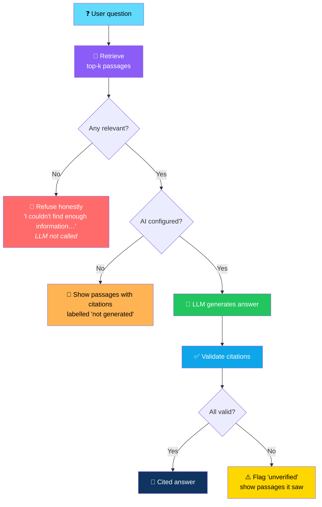
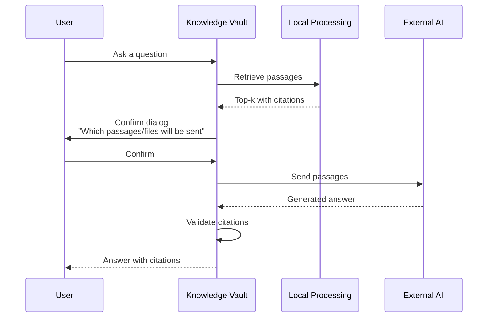
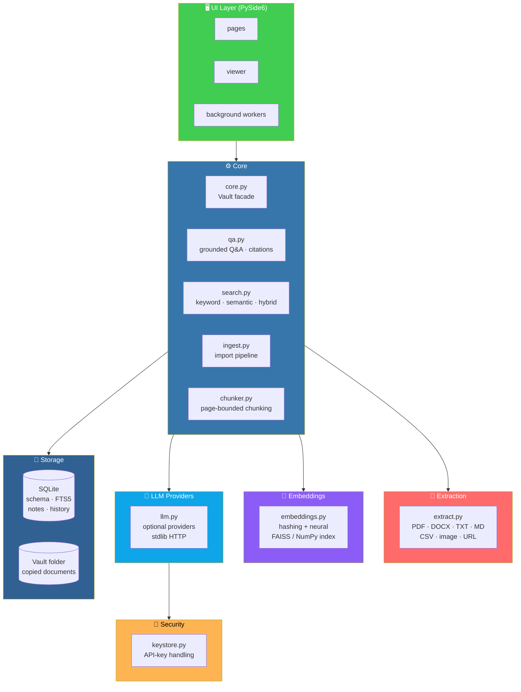

# 🧠 Knowledge Vault

<div align="center">


**Your documents. Your knowledge base. Your answers — with exact citations.**

*Turn your files into a searchable base that answers questions **only from your own documents**.*

[✨ Features](#-features) • [🛡️ Honesty Guarantees](#-honesty-guarantees) • [🔒 Privacy Model](#-privacy-model) • [🏗️ Architecture](#️-architecture) • [🧪 Tests](#-tests)

</div>

---

## 📖 Overview

**Knowledge Vault** is a **private, local-first desktop app** that turns your documents into a searchable knowledge base and answers questions **only from your own files — with exact citations**.

### The Pipeline


### Core Idea

> **Only from your files. Only with citations.**
>
> If nothing relevant is retrieved, the app says so — and the LLM isn't even called.

---

## ✨ Features

<div align="center">

| 📥 Import | 📚 Collections |
|:---:|:---:|
| **PDF · DOCX · TXT · Markdown · CSV · images (OCR) · web pages (URL)** · drag-and-drop · multi-select · whole folders · duplicates detected by **SHA-256** | Work · School · Research · Business · Personal + your own. **A document can be in several** |
| **🔎 Search** | **💬 Ask** |
| **Keyword** *(SQLite FTS5/BM25)* · **semantic** *(vector index)* · **hybrid** *(rank fusion)*. Filters: collection, file type, import date. Matches highlighted — **click to open the exact page** | Chat over your knowledge base. Every answer lists **`Source: <file> / Page N`** — clicking opens the page with terms highlighted |
| **📝 Notes** | **📊 Dashboard** |
| Markdown notes with folders, tags, search, live preview, and **links to documents** | Documents · collections · notes · storage · recent searches and questions |
| **🔒 Privacy** | **📋 Transparency** |
| Local by default | A banner **always states** whether processing is local or external |

</div>

### 📥 Import

**Supported formats:**

- PDF
- DOCX
- TXT
- Markdown
- CSV
- **Images** — with OCR
- **Web pages** — via URL

**Import methods:**

- **Drag-and-drop**
- **Multi-select**
- **Whole folders**

**Document table shows:**

- Filename
- Type
- Size
- Pages
- Import date
- Status

> 💡 **Duplicates are detected by SHA-256.**

### 📚 Collections

**Built-in:** Work · School · Research · Business · Personal

**Plus:** your own.

> 💡 **A document can be in several collections.**

### 🔎 Search

| Mode | How It Works |
|------|--------------|
| **Keyword** | SQLite **FTS5 / BM25** |
| **Semantic** | Vector index |
| **Hybrid** | Rank fusion |

**Filters:** collection · file type · import date

> 💡 **Matches are highlighted — click to open the exact page.**

### 💬 Ask

Chat over your knowledge base.

**Every answer lists:**

```
Source: <file> / Page N
```

> 💡 **Clicking opens the page with terms highlighted.**

### 📝 Notes

- **Markdown** notes with **folders** and **tags**
- **Search** and **live preview**
- **Links to documents**

### 📊 Dashboard

- Documents
- Collections
- Notes
- Storage
- Recent searches and questions

### 🔒 Privacy

**Local by default.**

> 💡 **A banner always states whether processing is local or external.**

---

## 🛡️ Honesty Guarantees

> **This is what makes Knowledge Vault different.**

<div align="center">

| Guarantee | Implementation |
|-----------|---------------|
| **🚫 No fake answers** | If nothing relevant is retrieved, the app replies exactly: *"I couldn't find enough information in your knowledge base to answer this."* — and the **LLM is not even called** |
| **📄 No AI configured?** | You get the **most relevant passages with citations**, labelled as *not generated* |
| **✅ LLM answers are checked** | Citation numbers **must refer to retrieved passages** — invalid ones are dropped. An answer with **no valid citation** is flagged **"unverified"** and **the passages it saw are shown** |
| **🧠 Semantic search, honestly described** | The default index is a **fast, dependency-free *lexical* hashing model** *(stemmed words + word pairs)*. It matches **related wording, not true synonyms**. For real neural semantic search, `pip install sentence-transformers` and choose it in Settings |

</div>

### Why "Semantic" Is Honest Here

> **The default index is lexical, not neural.**
>
> It matches **related wording** — not true synonyms. If you want real neural semantic search:
>
> ```bash
> pip install sentence-transformers
> ```
>
> Then choose it in **Settings**. It runs locally and **downloads the model once**.

### The Grounded Answer Pipeline



---

## 🔒 Privacy Model

<div align="center">

| Guarantee | How It's Enforced |
|-----------|------------------|
| **Files are copied, never modified** | Files are **copied** into the vault folder *(`%APPDATA%\KnowledgeVault` on Windows)* — **originals are never modified** |
| **Nothing uploaded by default** | Nothing is uploaded unless you **(1)** choose an external AI provider in Settings **and (2)** confirm each question in a dialog that lists **which passages/files will be sent** |
| **Indexing, OCR, and search never leave your machine** | Always local |
| **Web pages are opt-in** | Adding a web page downloads **that single URL** after you confirm — **nothing else touches the network** |
| **API keys are never hard-coded** | They come from: `KV_LLM_API_KEY` environment variable · OS keyring *(opt-in checkbox, needs `keyring`)* · or are held in memory for the session |
| **Local vs external is explicit** | **Ollama** and other servers on `localhost` are treated as **local** — **anything else is external** |

</div>

### The Consent Flow



---

## 🚀 Install & Run (Development)

**Requires Python 3.11+.**

```bash
python -m venv .venv
.venv\Scripts\activate           # Windows
# source .venv/bin/activate      # macOS/Linux

pip install -r requirements.txt
python -m knowledge_vault
```

### 🔤 OCR (Images and Scanned PDFs)

**1. Install the Tesseract engine:**

- **[Tesseract wiki](https://github.com/UB-Mannheim/tesseract/wiki)** — Windows installer

**2. Configure it in Knowledge Vault:**

- Add it to `PATH`, **or**
- Set **Settings → Tesseract path** *(e.g. `C:\Program Files\Tesseract-OCR\tesseract.exe`)*

**3. Extra languages:**

- Tick them in the installer
- Then set **OCR language** *(e.g. `eng+deu`)*

> 💡 **Scanned PDF pages** *(almost no text layer)* are OCR'd **automatically**.
>
> **If Tesseract is missing**, the document **still imports** and shows a **warning**.

### 🤖 Using a Local or External AI

#### Local *(Recommended)*

1. Install **[Ollama](https://ollama.com)**
2. Run `ollama pull <model>`
3. **Settings → provider: Ollama** · **model = that name**

#### External

1. Choose **Anthropic API** or **OpenAI-compatible**
2. Enter a model name and key

> ⚠️ **You are asked before every request.**
>
> **Settings → *Test AI connection* sends only a "ping".**

---

## 📎 Page Citations

<div align="center">

| Format | Citation Style |
|--------|---------------|
| **PDFs** | **Real page numbers** |
| **DOCX / TXT / MD / Web** | **`Section N`** |
| **CSV** | **`Rows 41–80`** |
| **Images** | **`Image`** |

</div>

> 💡 **Formats with no fixed pages get stable labels.**

---

## 🏗️ Architecture

### System Overview



### 🗂️ Project Layout

```
knowledge_vault/
├── core.py        Vault facade (db + embedder + index)
├── qa.py          grounded Q&A, citations
├── db.py          SQLite schema, FTS5, notes, history
├── llm.py         optional providers (stdlib HTTP)
├── extract.py     PDF/DOCX/TXT/MD/CSV/image/URL
├── search.py      keyword / semantic / hybrid + filters
├── chunker.py     page-bounded chunking
├── ingest.py      import pipeline
├── embeddings.py  hashing + neural embedders, FAISS/NumPy index
├── keystore.py    API-key handling
└── ui/            PySide6 pages, viewer, background workers

tests/
```

### Design Principles

<div align="center">

| Principle | Implementation |
|-----------|---------------|
| **🛡️ No fake answers** | If retrieval finds nothing, the app refuses — and the LLM is never called |
| **📎 Citations required** | Every LLM answer must cite a retrieved passage — invalid citations are dropped |
| **⚠️ Unverified is surfaced** | An answer with no valid citation is flagged and the passages it saw are shown |
| **🔍 Honest about the index** | The default semantic index is lexical, not neural — and says so |
| **🔒 Local-first** | Indexing, OCR, and search never leave your machine |
| **✅ Consent for external calls** | You confirm every question, seeing which passages/files will be sent |
| **📂 Originals untouched** | Files are copied into the vault — originals are never modified |
| **🔑 Keys stay out of config** | Environment variable, OS keyring, or memory only |
| **🔌 Providers are seams** | Ollama, Anthropic, OpenAI-compatible — all optional, all swappable |
| **🧪 Fully tested core** | `pytest` covers chunking, extraction, search, citations, and more |

</div>

---

## 🧪 Tests

```bash
python -m pytest -q
# or:
python -m unittest discover -s tests -t .
```

### What's Covered

<div align="center">

| Area | Coverage |
|------|:--------:|
| **Chunking** | ✅ |
| **Extraction** — CSV, DOCX, PDF | ✅ |
| **The import pipeline** | ✅ |
| **Keyword / semantic / hybrid search and filters** | ✅ |
| **Collections** | ✅ |
| **Notes** | ✅ |
| **Citation validation** | ✅ |
| **The "not enough information" path** | ✅ |
| **The external-consent guard** | ✅ |
| **Headless Qt smoke test** | ✅ — *auto-skipped without PySide6* |
| **PDF test** | ✅ — *auto-skipped without PyMuPDF* |

</div>

---

## 📦 Windows Packaging

```bat
build_windows.bat
```

**This will:**

1. Create a venv
2. Install dependencies
3. **Run the tests**
4. Build **`dist\KnowledgeVault\KnowledgeVault.exe`** with PyInstaller *(`knowledge_vault.spec`)*

**Distribute the whole `dist\KnowledgeVault` folder** *(zip it)* — or compile `installer.iss` with **[Inno Setup](https://jrsoftware.org/isinfo.php)** for a one-file installer.

### ⚠️ Packaging Notes

<div align="center">

| Note | Details |
|------|---------|
| **Tesseract is a separate install** | On the target PC — *or* bundle its folder and point Settings at it |
| **Exe won't start?** | Set `console=True` in the spec and rebuild to see the error |
| **`sentence-transformers` is large** | Including it makes the build very large — **the default build does not need it** |

</div>

---

## ⚠️ Known Limitations

<div align="center">

| Limitation | Details |
|-----------|---------|
| **Notes not in Q&A index** | Notes are searchable in the Notes page but are **not (yet) part of the Q&A index** |
| **DOCX has no reliable page numbers** | Sections are cited instead |
| **Neural embedder downloads the model** | The first import with the neural embedder downloads the model |
| **Qt UI not tested on a display** | The Qt UI was written **without access to a display** in the authoring environment. The core engine is fully unit-tested and the UI has a headless smoke test — **please report any platform-specific UI glitches** |

</div>

---

## 🗺️ Roadmap

### ✅ Current

- [x] Import PDF, DOCX, TXT, Markdown, CSV, images (OCR), web pages (URL)
- [x] Drag-and-drop, multi-select, whole folders
- [x] SHA-256 duplicate detection
- [x] Document table with filename, type, size, pages, import date, status
- [x] Collections — built-in plus custom, many-to-many
- [x] Keyword search via SQLite FTS5/BM25
- [x] Semantic search via vector index
- [x] Hybrid search via rank fusion
- [x] Filters — collection, file type, import date
- [x] Match highlighting with click-to-open
- [x] Grounded Q&A with `Source: <file> / Page N` citations
- [x] Honest refusal when nothing relevant is retrieved
- [x] Passage-only fallback when no AI is configured
- [x] Citation validation with "unverified" flagging
- [x] Markdown notes with folders, tags, search, live preview, and document links
- [x] Dashboard with documents, collections, notes, storage, recent activity
- [x] Privacy banner stating local vs external
- [x] OCR via Tesseract for images and scanned PDFs
- [x] Ollama, Anthropic, and OpenAI-compatible providers
- [x] OS keyring storage for API keys (opt-in)
- [x] Consent dialog before every external request
- [x] Files copied into vault — originals untouched
- [x] Stable page/section/row labels per format
- [x] PySide6 native UI
- [x] PyInstaller packaging with Inno Setup installer support
- [x] Test suite covering the full pipeline

### 🔜 Future Ideas

- [ ] **Notes in the Q&A index** — currently search-only
- [ ] **Additional providers** — Gemini, local llama.cpp server
- [ ] **Better DOCX page numbering** — or configurable section anchors
- [ ] **Multi-vault support** — separate knowledge bases
- [ ] **Backup and export** — vault as a portable archive
- [ ] **Additional formats** — EPUB, PPTX, XLSX
- [ ] **Folder watching** — auto-import new files
- [ ] **Search history UI** — browse and re-run past queries
- [ ] **Document versioning** — track changes across re-imports
- [ ] **Multilingual OCR presets**

---

## 🤝 Contributing

Contributions are welcome. Please:

1. Fork the repository
2. **Keep answers grounded** — never let the LLM answer without citations
3. **Keep the honest refusal** — if retrieval finds nothing, say so
4. **Preserve citation validation** — invalid citations must be dropped
5. **Never upload content without consent** — the confirmation dialog is not optional
6. **Never hard-code API keys** — environment, keyring, or memory only
7. **Keep originals untouched** — files are copied, never moved
8. **Add tests for any new extractor, search mode, or provider**
9. Submit a Pull Request

### Guidelines

- **Never fabricate content** — empty sections must say so
- **Never silently downgrade** — the semantic index must declare itself lexical if it is
- **Never log API keys or file contents**
- **Never break the vault folder layout** without a migration path
- **Never add a required runtime dependency beyond PySide6 and PyMuPDF**
- **Never ship without running the test suite** — `build_windows.bat` runs it for you

---

## 📜 License

MIT — see [LICENSE](LICENSE) for details.

---

## 🙏 Acknowledgments

- **SQLite FTS5** — for making keyword search fast and dependency-free
- **PyMuPDF** — for reliable PDF text and page numbers
- **Tesseract** — for OCR that actually works
- **Ollama** — for making local LLMs approachable
- **Every researcher who's ever had to cite their own notes back to themselves** — this is for you

---

<div align="center">

### 🧠 IMPORT. INDEX. ASK. CITE.

**Your documents. Your knowledge base. Your answers — with exact citations.**

**If it isn't in your files, it isn't in the answer.**

<br>

⭐ If Knowledge Vault helped you, consider giving it a star.

<br>

[⬆ Back to Top](#-knowledge-vault-)

</div>
